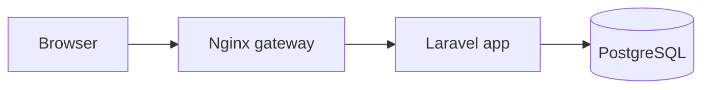

# README de un proyecto del portfolio

Lo leen dos personas: un recruiter (30 segundos: qué es, si hay demo, qué stack) y un tech lead (5 minutos: arquitectura, decisiones, calidad). La parte de arriba es para el primero; el resto, para el segundo.

## Reglas

- Inglés claro y simple, frases cortas. Sin relleno: nada de "blazing fast", "cutting-edge", "seamless" ni "robust".
- **Nada inventado.** Ni métricas, ni usuarios, ni clientes. Una cifra solo si la mediste y decís cómo (por ejemplo: "p95 of 120 ms with k6, 50 virtual users, on the home server").
- Si el proyecto nace de un problema del trabajo real, contalo sin nombres de clientes ni código bajo NDA.
- Imágenes en `docs/`: `screenshot.png` (1280×800) y `demo.gif` (10–20 s, menos de 5 MB), con texto alternativo descriptivo.
- Arquitectura en Mermaid: GitHub la renderiza.
- Credenciales: solo las de la demo, que se reinicia cada noche.
- Unas 200 líneas como máximo. Lo largo va a `docs/`.
- El título y el resumen coinciden con la tarjeta del proyecto en `site/content/projects.ts`.

## Plantilla

````markdown
# <Project name>

<One sentence: what it does and who it is for.>

[](https://github.com/AgustinBertero/portfolio/actions/workflows/<slug>.yml)

**Live demo:** https://agustinbertero.dev.ar/<slug>/ — user `demo@example.com`, password `demo-password` (data resets every night)


## Why

<2–4 sentences: the real problem, who has it, why existing tools fall short.>

## Features

- <What a user can do, not how it is built.>

## Architecture



<2–3 sentences walking through the diagram.>

## Tech stack

| Layer | Technology |
|---|---|
| Backend | |
| Frontend | |
| Data | |
| Infrastructure | Docker, Nginx, Cloudflare Tunnel, GitHub Actions |

## Key decisions

- **<Decision>.** <Why, what the alternative was, and the trade-off.>

## Security and privacy

<How data is protected. Link docs/privacy-review.md if it exists.>

## Run locally

```bash
cp .env.example .env
make up
```

Open http://localhost:<port>.

## Tests

```bash
make test
```

## What I would do next

- <Honest list of limitations and next steps.>

## License

MIT
````

## Antes de terminar

- Probá los comandos de "Run locally" desde un clon limpio.
- Revisá que funcionen todos los enlaces: demo, badge y `docs/`.
- Confirmá que la demo acepta las credenciales del README.
