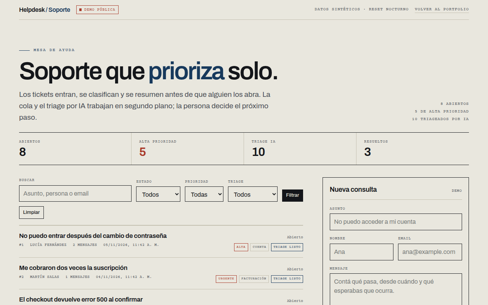
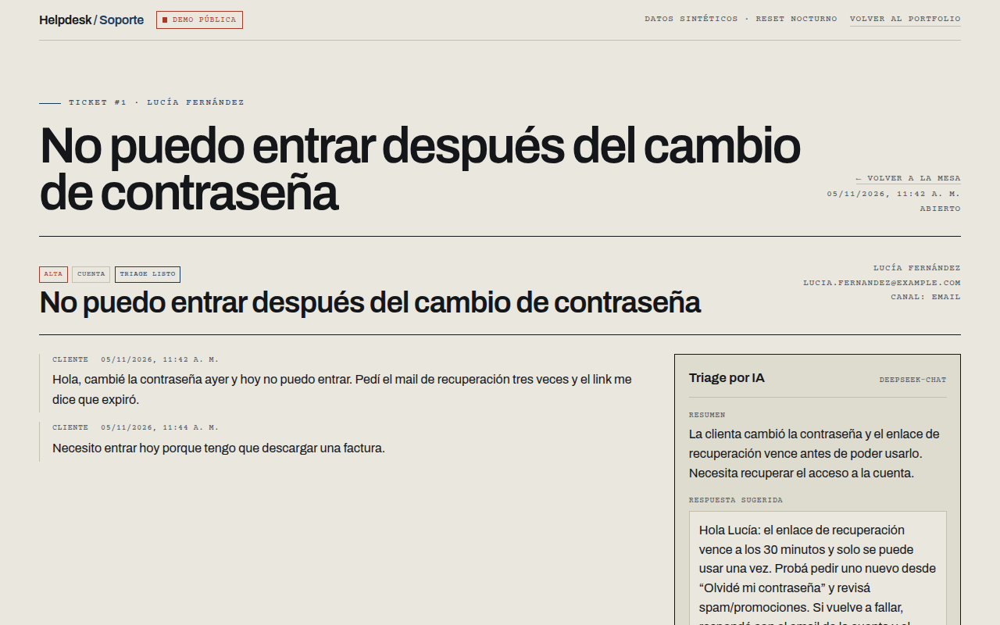
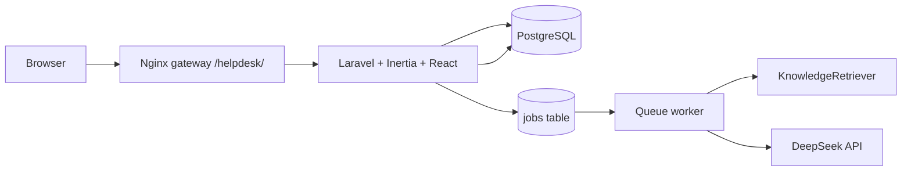

# Helpdesk with AI triage

A small support desk where a model classifies incoming tickets, estimates priority, summarises the thread and drafts a reply grounded in a synthetic knowledge base. The demo is public, uses synthetic data and resets every night.

**Live demo:** https://portfolio.bertium.net/helpdesk/ (no login)

## Screenshots





## The problem

Support teams spend the first minutes of every ticket deciding what it is, how urgent it is and whether the answer already exists in the knowledge base. In a queue with long threads, that decision is repeated before anyone can help.

This project keeps the human in control and moves the first pass to a queued job: category, priority, short summary, suggested reply and the knowledge-base articles used.

## Features

- Ticket queue with search, status/priority/triage filters and pagination.
- Ticket detail with the full thread and the AI triage panel.
- Asynchronous triage on a database queue; the UI polls while a job is running.
- Lexical retrieval over a seeded knowledge base, passed to the model as context (RAG).
- Strict JSON output, validated server-side; a deterministic rule-based fallback keeps the demo usable if the LLM is unavailable.
- “Create ticket” form for testing the queue; no registration, no email delivery.
- Demo reset command: `php artisan demo:reset --force`.

## Architecture



- Laravel 12, Inertia 2, React 19 and TypeScript.
- PostgreSQL in production, SQLite in the test suite.
- Database queue and database cache/session: the demo does not need Redis.
- DeepSeek chat completions via an OpenAI-compatible HTTP call.

## How triage works

1. The ticket and its messages are concatenated.
2. `KnowledgeRetriever` scores every seeded article by title, tags and body term overlap and returns the top three.
3. The prompt contains the thread and those articles, and asks for strict JSON: category, priority, summary, suggested reply and article ids.
4. The response is validated against allowed categories/priorities and only existing article ids are kept as citations.
5. If the API key is missing, the request fails or the JSON is invalid, `TriageService` falls back to keyword rules and records `rules-v1` as the model.

The model is instructed not to invent policies, prices, addresses or timelines. It may return an empty citation list.

## Key decisions

- **Laravel + Inertia instead of a separate API.** One deployable, server-side validation, CSRF and session handling, and a React UI without duplicating auth or CORS. The trade-off is that the frontend and backend ship together.
- **Database queue.** A demo with one worker does not need Redis; the `jobs` table is enough and keeps the compose stack small.
- **Lexical retrieval, not embeddings.** The knowledge base is small and the demo avoids a second paid API. The retriever is isolated behind one class, so swapping in pgvector later is contained.
- **Rule fallback.** The demo must still explain itself if the LLM key is missing or the provider is down.
- **Public demo, synthetic data.** Recruiters can open the app without credentials. There are no real customer records, file uploads or outbound emails.

## Security and privacy

- No registration and no login: the demo is read/write but rate-limited and resets nightly.
- All tickets, messages and knowledge articles are synthetic; the UI states it.
- The DeepSeek key is server-side only (`env/helpdesk.env`, never committed).
- The gateway limits the triage endpoint with the `ai` rate-limit zone.
- CSP, HSTS, `X-Content-Type-Options`, `Referrer-Policy` and `Permissions-Policy` come from the gateway.
- The container runs as a non-root user with `cap_drop: ALL` and `no-new-privileges`.

## Run locally

```bash
cd projects/helpdesk
cp .env.example .env
php artisan key:generate
composer install
npm ci
npm run build
touch database/database.sqlite
# set DB_CONNECTION=sqlite in .env for this local run
php artisan migrate --seed
php artisan serve
```

Open http://127.0.0.1:8000/. To exercise the queue:

```bash
php artisan queue:work
```

Or use the production-like compose stack:

```bash
cp .env.example .env
# set APP_KEY, DEEPSEEK_API_KEY and DB values
make up   # http://127.0.0.1:8088
```

## Tests

```bash
make ci
```

- Feature tests for the board, ticket creation, queue dispatch, validation and re-triage.
- Service tests for retrieval, LLM response parsing and the rule fallback.
- Demo reset test.

## Limitations / next steps

- Lexical retrieval will miss paraphrases that embeddings would catch; pgvector is the next step.
- The public write endpoint is rate-limited and reset nightly, not authenticated. A production helpdesk would add accounts, roles and an audit log.
- No attachments or email ingestion yet.
- The suggested reply is a draft; an agent must review it before sending.
