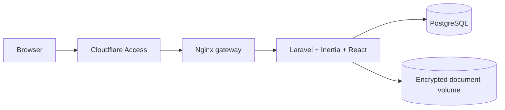

# Estudio — private legal case management

A private workspace for a small law practice: clients, cases, deadlines, tasks, documents and an audit trail. Built with Laravel, Inertia, React and TypeScript, and designed for one firm rather than a public demo.

**Private URL:** https://casos.bertium.net/ (login required; Cloudflare Access should gate the hostname)
**Status:** MVP in use / iterating

## Why

A solo practice needs the case file, the calendar and the document archive in one place, without turning client data into a SaaS experiment. The app keeps the working set small and explicit: who the client is, what the case is, what is due, what was filed, who touched it.

## Features

- Clients (people and companies) with tax id, contact data and case history.
- Cases with caratula, number, court, jurisdiction, matter, parties, status and dates.
- Deadlines with date/time, type, assignee, notes and a one-click “done”.
- Tasks, with or without a case.
- Documents linked to a case, encrypted at rest, downloaded through an authenticated route and hashed with SHA-256.
- Roles: owner, lawyer, assistant. Owner-only user management and audit.
- Audit log for login, CRUD, document upload/download/delete and user changes.
- Admin-created accounts only; no public registration.

## Stack

| Layer | Technology |
|---|---|
| Backend | Laravel 12, PHP 8.3 |
| UI | Inertia 2, React 19, TypeScript, Tailwind 4 |
| Database | PostgreSQL 17 in production; SQLite in tests |
| Files | Private local volume, AES encryption through Laravel `Crypt` |
| Edge | Nginx gateway, Cloudflare Tunnel, Cloudflare Access |

## Architecture



The app is served at the root of `casos.bertium.net`; the gateway only forwards that hostname to `legal-web:8080`. It is not linked from the public portfolio.

## Security and privacy

- **Real client data:** configure **Cloudflare Access** for `casos.bertium.net` before entering real data. Access adds an email-based second factor in front of the app; the app also requires a password.
- No public registration. The first owner is created from the server with `php artisan legal:create-owner`.
- Roles are enforced server-side. Assistants cannot delete clients, cases, documents or tasks; only the owner can manage users and read the audit log.
- Documents are encrypted before they reach the volume with `APP_KEY`; the filename is a UUID, never the original name in storage. Downloads are authenticated and audited.
- **Back up `APP_KEY` separately.** Without it, encrypted documents cannot be recovered.
- Audit log stores user, action, subject, IP and user agent. It is readable by the owner only.
- The app is `noindex, nofollow` and should not be exposed without Access.
- No upload of executables; PDF, JPG, PNG, DOC and DOCX up to 15 MB.

## Backups

The document volume is already encrypted, but it still needs an offsite copy. The intended setup is `restic` to Cloudflare R2/Backblaze B2 plus a nightly `pg_dump`; credentials and the restic password belong in `env/legal-backup.env` on the server, never in the repo. See `infra/scripts/legal-backup.sh`. Backups are not active until that file and the systemd timer are configured.

## Run locally

```bash
cd projects/legal-cases
cp .env.example .env
php artisan key:generate
composer install
npm ci
npm run build
touch database/database.sqlite
# set DB_CONNECTION=sqlite in .env
php artisan migrate --seed --seeder=LegalDemoSeeder
php artisan serve
```

Demo owner: `owner@example.com` / `DemoPassword123!` (synthetic data only).

## Tests

```bash
make ci
```

Covers login, inactive accounts, client/case creation, deadline/task completion, document encryption and download, role restrictions and the owner-only audit view.

## Limits / next phase

- Single firm; no multi-tenant isolation.
- No in-app TOTP; Access is the second factor for now.
- No billing, client portal, email reminders or court integrations.
- Parties are a text field, not a structured party table.
- Lexical search is not implemented yet; lists have filters.
- Reminder emails and a queue worker are next; the database queue is already configured.
