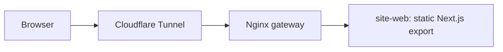

# Portfolio landing

Personal site of Agustin Bertero, full stack developer (PHP/Laravel, React, TypeScript, Linux and cloud). It is a static, bilingual page that answers three questions fast: what he builds, with which stack, and where the proof is.

**Live:** https://agustinbertero.dev.ar/ (Spanish) · https://agustinbertero.dev.ar/en/ (English)

## Why

Recruiters and hiring managers open a portfolio from LinkedIn or a job application, usually on a phone, and decide in under two minutes whether to open the CV. This page gives them the short version first: role, stack, real projects, experience and a downloadable CV, with no forms, cookies or tracking.

## Features

- Spanish at `/`, English at `/en/`, with per-language metadata and Open Graph tags.
- Cover sheet with availability seal and a file index; sections for exhibits (projects), record (experience), findings (stack), statement (about) and notice (contact).
- Project cards driven by `content/projects.ts`; the helpdesk project appears as “in progress” until its demo works.
- Contact by email and LinkedIn only. CV downloadable in a public version without the phone number.
- Self-hosted Archivo and Courier Prime, no third-party scripts, readable without JavaScript.

## Architecture



`next build` exports static HTML into `site/out/`; the image copies that directory into an unprivileged Nginx container. The gateway terminates TLS and proxies `/` to `site-web:8080`. There is no server runtime, database or API.

## Tech stack

| Layer | Technology |
|---|---|
| Frontend | Next.js 16, React 19, TypeScript, Tailwind 4 |
| Output | Static export (`output: 'export'`, `trailingSlash: true`) |
| Infrastructure | Docker, nginx-unprivileged, Nginx gateway, Cloudflare Tunnel, GitHub Actions |

## Key decisions

- **Static export instead of a Node server.** The page has no dynamic data; a static export removes a runtime and most of the attack surface. The trade-off is that metadata and routes are resolved at build time.
- **A case file, not a hero.** The visual system (paper, rules, folios, stamp) comes from the legal background and gives the page a structure that is hard to confuse with a template. The first viewport is the cover sheet; the design contract lives in `DESIGN.md`.
- **Two root layouts for two languages.** `/` and `/en/` carry their own `<html lang>`, metadata and alternates without client-side language switching.
- **No contact form.** Email and LinkedIn are enough; a form would add spam, storage and privacy work for no gain.
- **Content in TypeScript, not Markdown.** Profile facts live in `content/profile.ts` and project cards in `content/projects.ts`, so the landing and the CV read from one source.

## Security and privacy

No cookies, analytics or third-party requests. Fonts are self-hosted. The public CV omits the phone number. The gateway sets a CSP that allows the inline scripts Next.js emits in a static export, with `frame-ancestors 'none'` and no `unsafe-eval`. The container runs read-only, without capabilities and as a non-root user.

## Run locally

```bash
cd site
make install
make dev            # http://localhost:3000
```

Or build the production image:

```bash
cd site
make up             # http://127.0.0.1:8080
make down
```

## Tests

```bash
cd site
make test
```

`make test` builds the export and runs `scripts/smoke.mjs`: routes, `lang`/alternates, metadata and JSON-LD, no phone or `tel:` link, no third-party script/style, PDF size and internal links.

## What I would do next

- Replace the placeholder repository URL on the “This site” card when the repo is public.
- Publish the helpdesk demo and move its card from `wip` to `live`.
- Add a real screenshot or short capture to `docs/` once the demo exists.

## License

MIT
